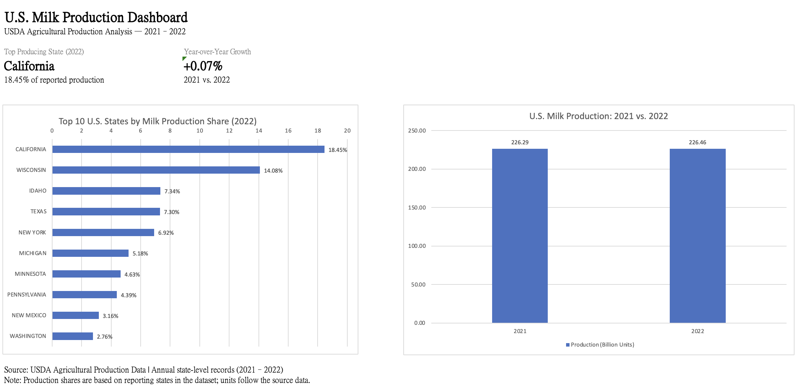

# USDA Agricultural Production Analysis | SQL Portfolio

A course final project extended into a small SQL portfolio using agricultural production data provided for the course from the U.S. Department of Agriculture (USDA). The project focuses on data quality checks, relational SQL, and descriptive analysis of U.S. milk production.

## Tools and skills

- **SQLite and DBeaver:** table creation, data exploration, and SQL queries
- **Data cleaning:** `TYPEOF()`, `LENGTH()`, `HEX()`, `TRIM()`, `REPLACE()`, `CASE WHEN`, `CAST()`, and SQL views
- **Analysis:** `INNER JOIN`, `LEFT JOIN`, subqueries, `GROUP BY`, `SUM()`, `AVG()`, `COUNT()`, common table expressions (CTEs), and window functions including `SUM() OVER()` and `LAG()`
- **Excel:** presentation of query results in a dashboard

## Dataset and approach

The project uses **seven tables**: six production tables (`milk_production`, `cheese_production`, `honey_production`, `coffee_production`, `egg_production`, and `yogurt_production`) plus a `state_lookup` table.

1. Defined the tables in SQLite and imported course-provided CSV files through DBeaver.
2. Checked the stored types of production values and investigated nonnumeric entries. For example, two cheese records contained a leading space before `(D)`, identified with `LENGTH()` and `HEX()`.
3. Built cleaned SQL views to preserve original values while treating identified `(D)` and `(NA)` codes as missing (`NULL`) rather than zero.
4. Used joins, aggregations, subqueries, CTEs, and window functions to answer course questions and analyze milk-production patterns.
5. Validated that the 2021 and 2022 annual milk-production records covered the same **49 state codes** before comparing aggregate totals.

## Key findings

- **California** had the highest reported milk production in 2022, with **41.787 billion source-data units**, accounting for **18.45%** of the sum across reporting states matched to the lookup table.
- **Wisconsin** ranked second with **14.08%**; together, California and Wisconsin represented **32.53%** of the comparable reported total.
- The dataset's 2021 and 2022 annual state-level milk-production totals were **226.293 billion** and **226.462 billion source-data units**, respectively, equivalent to approximately **+0.07% year-over-year growth**.

## Dashboard

The dashboard was prepared in Excel from exported SQL query results. The editable workbook is included to make the charts and calculations inspectable.

## Repository files

| File | Description |
| --- | --- |
| `01_create_tables.sql` | Definitions for the seven database tables |
| `02_data_cleaning.sql` | SQL views for handling identified missing and suppressed values |
| `03_analysis.sql` | Foundational course queries, milk production rankings, shares, growth, and state-coverage validation |
| `top10_milk_2022.csv` | Query result: ten highest-ranking milk-producing states in 2022 |
| `milk_production_share_2022.csv` | Query result: 2022 state production shares |
| `milk_yoy_growth.csv` | Query result: 2021–2022 annual production comparison |
| `USDA_Milk_Production_Dashboard.xlsx` | Editable Excel dashboard |
| `dashboard.png` | Dashboard preview |

## Interpretation and limitations

- Production share is computed from the **available annual state-level records joined to the state lookup**, not independently verified against the USDA's official national total.
- The year-over-year calculation uses the **same set of 49 state codes** in both years. Matching coverage does not rule out other measurement or reporting differences.
- **Measurement units should be confirmed against the original USDA dataset documentation** before interpreting the absolute quantities. This analysis does not treat different commodities' production measures as interchangeable.
- Suppressed or unavailable values were not replaced with zero. The source material and table import/cleanup steps should be reviewed before rerunning the scripts on fresh raw CSV files.

## Origin

Extended from a course SQL final project using USDA-sourced datasets. SQL analysis and dashboard preparation were completed in DBeaver/SQLite and Excel, respectively, with guidance and editorial assistance during portfolio preparation.
